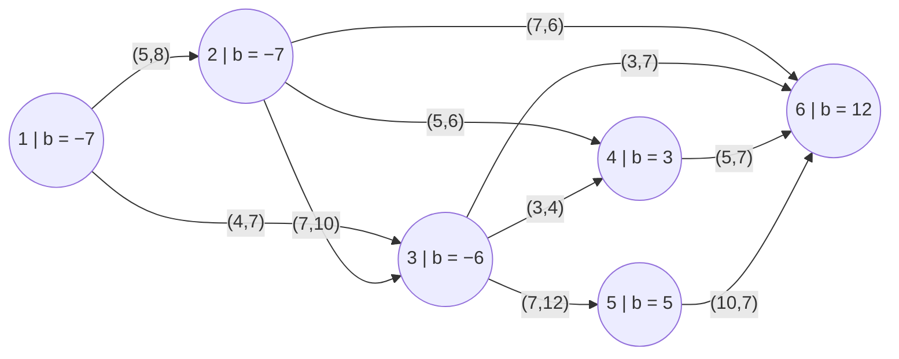

# Prova 16-11-2026

## Esercizio 1

Un'azienda produce palloni da calcio e da basket che vende a 15 e 20 euro rispettivamente. L'azienda compra ogni settimana $40.000\ \text{dm}^2$ di cuoio e ha bisogno di $13\ \text{dm}^2$ di cuoio per produrre un pallone da calcio e di $16\ \text{dm}^2$ per uno da basket. La produzione di un pallone da calcio richiede 12 minuti di lavoro di una macchina mentre quello da basket ne richiede 8. Le 10 macchine a disposizione dell'azienda possono lavorare 12 ore al giorno per 5 giorni a settimana. Dovendo produrre almeno 1000 palloni da calcio ed almeno 800 da basket a settimana, l'azienda vuole determinare la produzione settimanale che massimizza il profitto. La soluzione $x = (1000, 800)$ può essere quella di partenza del simplesso applicato al rilassato continuo? Se sì, effettuarne un passo. Costruire un piano di taglio di Gomory.

## Esercizio 2

Consideriamo la seguente rete (su ogni arco sono indicati, nell'ordine, il costo e la capacità).

**Archi** (costo $c_{ij}$, capacità $u_{ij}$):

| Arco  | Costo | Capacità |
|-------|-------|----------|
| (1,2) | 5     | 8        |
| (1,3) | 4     | 7        |
| (2,3) | 7     | 10       |
| (2,4) | 5     | 6        |
| (2,6) | 7     | 6        |
| (3,4) | 3     | 4        |
| (3,5) | 7     | 12       |
| (3,6) | 3     | 7        |
| (4,6) | 5     | 7        |
| (5,6) | 10    | 7        |

**Bilanci dei nodi:**

| Nodo     | 1  | 2  | 3  | 4 | 5 | 6  |
|----------|----|----|----|---|---|----|
| Bilancio | −7 | −7 | −6 | 3 | 5 | 12 |

Considerando l'albero di copertura formato dagli archi $(1,2)$, $(2,3)$, $(2,6)$, $(4,6)$, $(5,6)$ e gli archi $(2,4)$ e $(3,5)$ come archi in $U$, il flusso ottenuto è degenere? Il potenziale complementare è degenere? Fare due passi dell'algoritmo del simplesso su reti. Determinare costi, bilanci e capacità in una rete (4 nodi/5 archi) che abbia due flussi ottimi non degeneri.

## Esercizio 3

Considerare la rete dell'esercizio 2.

a) Determinare e disegnare l'albero dei cammini di costo minimo di radice 1 tramite Dijkstra. Scrivere la soluzione in termini di flusso su reti.

b) Considerato il problema del flusso massimo, fare un passo del simplesso partendo dal flusso $x = (6, 7, 0, 6, 0, 0, 7, 0, 6, 7)$, se possibile. Trovare, con l'algoritmo FFEK, il taglio da 1 a 6 di capacità minima.

> [!note] Nota di trascrizione
> Nel testo originale il flusso è stampato come $(6,7,0,6,0,0,7,0.6,7)$: il punto tra 0 e 6 è un refuso per una virgola (servono 10 componenti, una per arco). Le componenti seguono l'ordine degli archi nella tabella sopra: $(1,2), (1,3), (2,3), (2,4), (2,6), (3,4), (3,5), (3,6), (4,6), (5,6)$.
