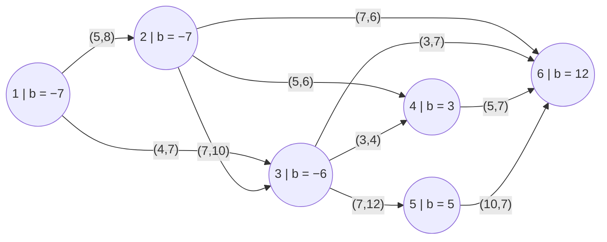
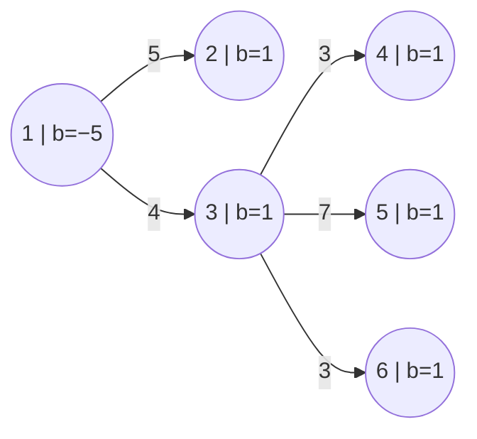

# 2026-11-16 Prova con soluzioni

Testo della prova del 16-11-2026 seguito dalle soluzioni. Convenzioni del corso (Pappalardo):

- PL: $\max\ c^Tx,\ Ax \le b$; $W = -A_B^{-1}$; simplesso primale con $h = \min\{i \in B : y_i < 0\}$ e $k = \arg\min$ dei rapporti (Bland).
- Reti: modello $\min\ c^Tx,\ Ex = b,\ 0 \le x \le u$ (entrante − uscente $= b_i$); flusso di base con la visita posticipata per foglie, potenziali nodali con la visita anticipata dalla radice ($\pi_1 = 0$); costi ridotti $c^\pi_{ij} = c_{ij} + \pi_i - \pi_j$ e condizioni di Bellman ($\ge 0$ su $L$, $\le 0$ su $U$). Dettagli nel riquadro all'inizio della soluzione dell'esercizio 2.

---

# Testo

## Esercizio 1

Un'azienda produce palloni da calcio e da basket che vende a 15 e 20 euro rispettivamente. L'azienda compra ogni settimana $40.000\ \text{dm}^2$ di cuoio e ha bisogno di $13\ \text{dm}^2$ di cuoio per produrre un pallone da calcio e di $16\ \text{dm}^2$ per uno da basket. La produzione di un pallone da calcio richiede 12 minuti di lavoro di una macchina mentre quello da basket ne richiede 8. Le 10 macchine a disposizione dell'azienda possono lavorare 12 ore al giorno per 5 giorni a settimana. Dovendo produrre almeno 1000 palloni da calcio ed almeno 800 da basket a settimana, l'azienda vuole determinare la produzione settimanale che massimizza il profitto. La soluzione $x = (1000, 800)$ può essere quella di partenza del simplesso applicato al rilassato continuo? Se sì, effettuarne un passo. Costruire un piano di taglio di Gomory.

## Esercizio 2

Consideriamo la seguente rete (su ogni arco sono indicati, nell'ordine, il costo e la capacità).

| Arco  | Costo | Capacità |
|-------|-------|----------|
| (1,2) | 5     | 8        |
| (1,3) | 4     | 7        |
| (2,3) | 7     | 10       |
| (2,4) | 5     | 6        |
| (2,6) | 7     | 6        |
| (3,4) | 3     | 4        |
| (3,5) | 7     | 12       |
| (3,6) | 3     | 7        |
| (4,6) | 5     | 7        |
| (5,6) | 10    | 7        |

| Nodo     | 1  | 2  | 3  | 4 | 5 | 6  |
|----------|----|----|----|---|---|----|
| Bilancio | −7 | −7 | −6 | 3 | 5 | 12 |

Considerando l'albero di copertura formato dagli archi $(1,2)$, $(2,3)$, $(2,6)$, $(4,6)$, $(5,6)$ e gli archi $(2,4)$ e $(3,5)$ come archi in $U$, il flusso ottenuto è degenere? Il potenziale complementare è degenere? Fare due passi dell'algoritmo del simplesso su reti. Determinare costi, bilanci e capacità in una rete (4 nodi/5 archi) che abbia due flussi ottimi non degeneri.

## Esercizio 3

Considerare la rete dell'esercizio 2.

a) Determinare e disegnare l'albero dei cammini di costo minimo di radice 1 tramite Dijkstra. Scrivere la soluzione in termini di flusso su reti.

b) Considerato il problema del flusso massimo, fare un passo del simplesso partendo dal flusso $x = (6, 7, 0, 6, 0, 0, 7, 0, 6, 7)$, se possibile. Trovare, con l'algoritmo FFEK, il taglio da 1 a 6 di capacità minima.

> [!note] Nota di trascrizione
> Nel testo il flusso è stampato come $(6,7,0,6,0,0,7,0.6,7)$: il punto è un refuso per una virgola (servono 10 componenti, una per arco).

---

# Soluzioni

I flussi sono sempre scritti nell'ordine lessicografico degli archi:
$$(x_{12},\ x_{13},\ x_{23},\ x_{24},\ x_{26},\ x_{34},\ x_{35},\ x_{36},\ x_{46},\ x_{56})$$
e i potenziali come $(\pi_1, \dots, \pi_6)$.

## Esercizio 1

**Modello.** $x_1$ = palloni da calcio, $x_2$ = palloni da basket (a settimana). Minuti macchina disponibili: $10 \cdot 12 \cdot 5 \cdot 60 = 36000$, quindi $12x_1 + 8x_2 \le 36000$, cioè (dividendo per 4) $3x_1 + 2x_2 \le 9000$.

$$
\begin{cases}
\max\ 15x_1 + 20x_2 \\
13x_1 + 16x_2 \le 40000 & (1)\ \text{cuoio} \\
3x_1 + 2x_2 \le 9000 & (2)\ \text{macchine} \\
-x_1 \le -1000 & (3) \\
-x_2 \le -800 & (4) \\
x \in \mathbb{Z}^2
\end{cases}
$$

($x \ge 0$ è implicato da (3) e (4).)

**$x = (1000, 800)$ può essere la partenza?** Sì. Attiva i vincoli 3 e 4, che sono linearmente indipendenti, quindi è il vertice di base $B = \{3,4\}$. È ammissibile: $13000 + 12800 = 25800 \le 40000$ e $3000 + 1600 = 4600 \le 9000$. Ed è non degenere (gli altri vincoli non sono attivi).

**Passo del simplesso.** $A_B = -I$, quindi $W = -A_B^{-1} = I$, $W^3 = (1, 0)$, $W^4 = (0, 1)$.

$y_B$ da $y_3 A_3 + y_4 A_4 = c$: $y_3 = -15$, $y_4 = -20$, quindi $y = (0, 0, -15, -20)$ non ammissibile.

| $B$ | $x$ | $y$ | $h$ | $W^h$ | $A_iW^h$ | rapporti | $k$ |
|---|---|---|---|---|---|---|---|
| $\{3,4\}$ | $(1000,\ 800)$ | $(0, 0, -15, -20)$ | 3 | $(1, 0)$ | $A_1: 13,\ A_2: 3$ | $r_1 = \frac{14200}{13} \approx 1092.3,\ r_2 = \frac{4400}{3} \approx 1466.7$ | 1 |

Nuova base $B = \{1,4\}$: $x = \left(\frac{27200}{13},\ 800\right) \approx (2092.3,\ 800)$, valore $\frac{616000}{13} \approx 47384.6$. Qui $y = \left(\frac{15}{13},\ 0,\ 0,\ -\frac{20}{13}\right)$: non è ancora ottima.

**Secondo passo (per arrivare all'ottimo, serve per Gomory).** $W^1 = \left(-\frac1{13},\ 0\right)$, $W^4 = \left(-\frac{16}{13},\ 1\right)$; $h = 4$. $A_2W^4 = -\frac{22}{13} < 0$, $A_3W^4 = \frac{16}{13} > 0$ con $r_3 = \frac{14200/13}{16/13} = 887.5$, quindi $k = 3$.

$B = \{1,3\}$: $x = (1000,\ 1687.5)$, $y = \left(\frac54,\ 0,\ \frac54,\ 0\right) \ge 0$: **ottima** per il rilassato, valore $48750$.

(In pratica conviene il basket: rende $20/16 = 1.25$ euro per $\text{dm}^2$ di cuoio contro $15/13 \approx 1.15$ del calcio, e il vincolo che lega è il cuoio. Il primo passo, con la regola di Bland, va nella direzione "sbagliata" aumentando $x_1$.)

**Valutazioni.** $v_S = 48750$; $\lfloor \bar x \rfloor = (1000, 1687)$ è ammissibile, quindi $v_I = 48740$. (Controllo al computer: l'ottimo intero è $(1003, 1685)$ con valore $48745$.)

**Taglio di Gomory.** Forma standard: $x_3$ scarto del cuoio, $x_4$ scarto delle macchine, $x_5 = x_1 - 1000$, $x_6 = x_2 - 800$. In base: $x_1, x_2, x_4, x_6$; fuori base $x_3, x_5$. Dalla riga del cuoio, con $x_1 = 1000 + x_5$:

$$16x_2 + x_3 + 13x_5 = 27000 \quad\Rightarrow\quad x_2 + \tfrac1{16}x_3 + \tfrac{13}{16}x_5 = 1687.5$$

Taglio sulla riga di $x_2$ (parte frazionaria $\frac12$):

$$\tfrac1{16}x_3 + \tfrac{13}{16}x_5 \ge \tfrac12 \quad\Longleftrightarrow\quad x_3 + 13x_5 \ge 8$$

Sostituendo $x_3 = 40000 - 13x_1 - 16x_2$ e $x_5 = x_1 - 1000$: $27000 - 16x_2 \ge 8$, cioè

$$x_2 \le 1687$$

che taglia $\bar x$ ($1687.5 > 1687$). Le righe di $x_1$ ($x_1 - x_5 = 1000$) e di $x_4$ ($x_4 - \frac18x_3 + \frac{11}8x_5 = 2625$) hanno termine noto intero e non danno tagli; quella di $x_6$ dà lo stesso taglio.

---

## Esercizio 2

> [!info] Come si ragiona nel corso
> - **Modello:** $\min\ c^Tx$, $Ex = b$, $0 \le x \le u$. Per ogni nodo: flusso entrante $-$ flusso uscente $= b_i$ ($b_i < 0$: il nodo immette flusso, $b_i > 0$: lo richiede).
> - **Base = tripartizione** $(T, L, U)$: $T$ albero di copertura ($n - 1 = 5$ archi), $L$ archi fissati a 0, $U$ archi fissati alla portata. La soluzione di base è $(x_T,\ x_L,\ x_U) = (x_T,\ 0,\ u_U)$.
> - **Flusso di base** $\bar x$: si risolve $E_T x_T = b - E_U u_U$ con la *visita posticipata per foglie*: si prende una foglia dell'albero e si mette sul suo arco il valore che soddisfa il bilancio, contando anche le unità imposte dagli archi di $U$.
>   - Non ammissibile se $x_T < 0$ oppure $u_T - x_T < 0$.
>   - Degenere se un arco di $T$ ha $x_{ij} = 0$ oppure $x_{ij} = u_{ij}$.
> - **Potenziali nodali** $\bar\pi$ (variabili del duale $\max\ b^T\pi$, $-\pi_i + \pi_j \le c_{ij}$): si risolve $\pi^T E_T = c_T$, cioè $c^\pi_{ij} = 0$ su $T$, con la *visita anticipata dalla radice*: $\pi_1 = 0$, poi $\pi_j = \pi_i + c_{ij}$ se si percorre l'arco $(i,j)$ nel suo verso, $\pi_i = \pi_j - c_{ij}$ se lo si percorre al contrario.
> - **Costi ridotti** $c^\pi_{ij} = c_{ij} + \pi_i - \pi_j$. **Condizioni di Bellman** (ammissibilità del duale): $c^\pi_{ij} \ge 0$ su $L$, $c^\pi_{ij} \le 0$ su $U$.
>   - Il potenziale è degenere se $c^\pi_{ij} = 0$ per qualche arco di $L$ o di $U$.
> - **Passo:** entra $k$, il primo arco in ordine lessicografico che viola Bellman. Il ciclo $C = C^+ \cup C^-$ si orienta concorde a $k$ se $k \in L$ (caso 1), discorde se $k \in U$ (caso 2). $\vartheta^+ = \min_{C^+}\{u_{ij} - x_{ij}\}$ (archi concordi), $\vartheta^- = \min_{C^-}\{x_{ij}\}$ (archi discordi), $\vartheta = \min\{\vartheta^+, \vartheta^-\}$. Esce $h$, il primo in ordine lessicografico che raggiunge $\vartheta$: se si satura va in $U$, se si svuota va in $L$.
> - **Teorema della convenienza:** caso 1: $c^Tx(\vartheta) = c^T\bar x + \vartheta\, c^\pi_k$ con $c^\pi_k < 0$; caso 2: $c^Tx(\vartheta) = c^T\bar x - \vartheta\, c^\pi_k$ con $c^\pi_k > 0$. In entrambi i casi il costo scende di $\vartheta\,|c^\pi_k|$.

### Flusso e potenziale di base

$T = \{(1,2),\ (2,3),\ (2,6),\ (4,6),\ (5,6)\}$, $U = \{(2,4),\ (3,5)\}$, $L = \{(1,3),\ (3,4),\ (3,6)\}$.

**Flusso (visita posticipata per foglie).** Archi di $L$ a 0, archi di $U$ alla portata: $x_{24} = 6$, $x_{35} = 12$. Le foglie dell'albero sono 1, 3, 4, 5:

| Foglia | Bilancio (entrante $-$ uscente $= b_i$) | Arco di $T$ |
|---|---|---|
| 1 | $-x_{12} = -7$ | $x_{12} = 7$ |
| 3 | $x_{23} - x_{35} = x_{23} - 12 = -6$ | $x_{23} = 6$ |
| 4 | $x_{24} - x_{46} = 6 - x_{46} = 3$ | $x_{46} = 3$ |
| 5 | $x_{35} - x_{56} = 12 - x_{56} = 5$ | $x_{56} = 7$ |
| 2 | $x_{12} - x_{23} - x_{24} - x_{26} = 7 - 6 - 6 - x_{26} = -7$ | $x_{26} = 2$ |

(controllo sul nodo 6: $2 + 0 + 3 + 7 = 12$ ✓)

**Potenziali nodali (visita anticipata dalla radice 1).**

| Arco di $T$ | verso di percorrenza | Potenziale |
|---|---|---|
| (1,2) | concorde | $\pi_2 = \pi_1 + 5 = 5$ |
| (2,3) | concorde | $\pi_3 = \pi_2 + 7 = 12$ |
| (2,6) | concorde | $\pi_6 = \pi_2 + 7 = 12$ |
| (4,6) | discorde | $\pi_4 = \pi_6 - 5 = 7$ |
| (5,6) | discorde | $\pi_5 = \pi_6 - 10 = 2$ |

**Test di Bellman sugli archi fuori base:**

| Arco | Insieme | $c^\pi_{ij} = c_{ij} + \pi_i - \pi_j$ | Bellman |
|---|---|---|---|
| (1,3) | $L$ | $4 + 0 - 12 = -8$ | violata |
| (2,4) | $U$ | $5 + 5 - 7 = 3$ | violata |
| (3,4) | $L$ | $3 + 12 - 7 = 8$ | ok |
| (3,5) | $U$ | $7 + 12 - 2 = 17$ | violata |
| (3,6) | $L$ | $3 + 12 - 12 = 3$ | ok |

| Vettore | Archi di $T$ | Archi di $U$ | Ammissibile | Degenere | Ottimo |
|---|---|---|---|---|---|
| $x = (7, 0, 6, 6, 2, 0, 12, 0, 3, 7)$ | (1,2) (2,3) (2,6) (4,6) (5,6) | (2,4) (3,5) | SI | **SI** | NO |
| $\pi = (0, 5, 12, 7, 2, 12)$ | (1,2) (2,3) (2,6) (4,6) (5,6) | (2,4) (3,5) | NO | **NO** | NO |

- Il **flusso è degenere**: $(5,6) \in T$ è saturo ($u_{56} - x_{56} = 0$), quindi la stessa $x$ si ottiene anche con altre basi (per esempio con $(5,6)$ in $U$).
- Il **potenziale non è degenere**: nessun arco di $L$ o di $U$ ha costo ridotto nullo. Non è ammissibile perché viola Bellman su $(1,3)$, $(2,4)$, $(3,5)$.
- Costo del flusso: $c^T\bar x = 35 + 42 + 30 + 14 + 84 + 15 + 70 = 290$. Il flusso non è ottimo (l'ottimo vale 132, vedi sotto).

### Due passi del simplesso

| | passo 1 | passo 2 |
|---|---|---|
| Archi di $T$ | (1,2) (2,3) (2,6) (4,6) (5,6) | (1,2) (1,3) (2,6) (4,6) (5,6) |
| Archi di $U$ | (2,4) (3,5) | (2,4) (3,5) |
| $x$ | $(7, 0, 6, 6, 2, 0, 12, 0, 3, 7)$ | $(1, 6, 0, 6, 2, 0, 12, 0, 3, 7)$ |
| costo di $x$ | 290 | 242 |
| $\pi$ | $(0, 5, 12, 7, 2, 12)$ | $(0, 5, 4, 7, 2, 12)$ |
| $k$ (arco entrante) | (1,3) | (2,4) |
| $\vartheta^+$ (archi concordi) | 7 | 4 |
| $\vartheta^-$ (archi discordi) | 6 | 3 |
| $h$ (arco uscente) | (2,3) | (4,6) |

**Passo 1 — caso 1, $\vartheta = \vartheta^-$ (un arco si svuota).**
- Entra $k = (1,3) \in L$ con $c^\pi_{13} = -8 < 0$.
- Ciclo concorde a $(1,3)$: $1 \to 3 \to 2 \to 1$. $C^+ = \{(1,3)\}$, $C^- = \{(1,2),\ (2,3)\}$.
- $\vartheta^+ = u_{13} - x_{13} = 7$; $\vartheta^- = \min\{x_{12}, x_{23}\} = \min\{7, 6\} = 6$; $\vartheta = 6$.
- Esce $h = (2,3)$, che si svuota e va in $L$.
- $x(\vartheta)$: $x_{13} = 0 + 6$, $x_{12} = 7 - 6$, $x_{23} = 6 - 6$.
- Convenienza: $c^Tx(\vartheta) = 290 + 6 \cdot (-8) = 242$.

Nuovi potenziali: cambia solo il sottoalbero di 3, che ora è appeso a 1: $\pi_3 = \pi_1 + 4 = 4$. Test sui fuori base: $(2,3) \in L$: $7 + 5 - 4 = 8$ ok; $(2,4) \in U$: $5 + 5 - 7 = 3 > 0$, violata (è la prima).

**Passo 2 — caso 2, $\vartheta = \vartheta^-$ (un arco si svuota).**
- Entra $k = (2,4) \in U$ con $c^\pi_{24} = 3 > 0$.
- Ciclo discorde a $(2,4)$: $4 \to 2 \to 6 \to 4$. $C^+ = \{(2,6)\}$, $C^- = \{(2,4),\ (4,6)\}$.
- $\vartheta^+ = u_{26} - x_{26} = 6 - 2 = 4$; $\vartheta^- = \min\{x_{24}, x_{46}\} = \min\{6, 3\} = 3$; $\vartheta = 3$.
- Esce $h = (4,6)$, che si svuota e va in $L$; $(2,4)$ passa da $U$ a $T$.
- $x(\vartheta)$: $x_{26} = 2 + 3$, $x_{24} = 6 - 3$, $x_{46} = 3 - 3$.
- Convenienza: $c^Tx(\vartheta) = 242 - 3 \cdot 3 = 233$.

Dopo due passi: $T = \{(1,2), (1,3), (2,4), (2,6), (5,6)\}$, $U = \{(3,5)\}$, $L = \{(2,3), (3,4), (3,6), (4,6)\}$,
$$x = (1,\ 6,\ 0,\ 3,\ 5,\ 0,\ 12,\ 0,\ 0,\ 7) \qquad \text{costo } 233 \qquad \pi = (0,\ 5,\ 4,\ 10,\ 2,\ 12)$$
Non è ancora ottimo: $(3,4) \in L$ ha $c^\pi_{34} = 3 + 4 - 10 = -3$.

> [!tip] Controllo
> Continuando, l'algoritmo si ferma dopo altri 4 passi con $x = (0, 7, 0, 2, 5, 1, 5, 7, 0, 0)$, costo **132**, e $\pi = (0, 2, 4, 7, 11, 9)$ (verificato al computer).

### Rete con due flussi ottimi non degeneri

Serve un potenziale ottimo **degenere**: un arco fuori base con $c^\pi_{ij} = 0$. Facendolo entrare il costo non cambia ($\vartheta \cdot c^\pi = 0$), e se $\vartheta > 0$ si arriva a un altro flusso, sempre ottimo. In pratica: due cammini da 1 a 4 con lo stesso costo, $1 \to 2 \to 4$ e $1 \to 3 \to 4$ (costo 5 entrambi).

| Arco | Costo | Capacità |
|---|---|---|
| (1,2) | 2 | 3 |
| (1,3) | 4 | 3 |
| (2,3) | 3 | 2 |
| (2,4) | 3 | 4 |
| (3,4) | 1 | 4 |

Bilanci $b = (-4,\ 0,\ 0,\ 4)$. Flussi nell'ordine $(x_{12}, x_{13}, x_{23}, x_{24}, x_{34})$.

| Vettore | Archi di $T$ | Archi di $U$ | Ammissibile | Degenere | Ottimo |
|---|---|---|---|---|---|
| $x = (3, 1, 0, 3, 1)$ | (1,3) (2,4) (3,4) | (1,2) | SI | NO | SI |
| $x = (1, 3, 0, 1, 3)$ | (1,2) (2,4) (3,4) | (1,3) | SI | NO | SI |
| $\pi = (0, 2, 4, 5)$ | | | SI | SI | SI |

- Non degeneri: sugli archi di $T$ si ha sempre $0 < x_{ij} < u_{ij}$.
- Potenziali (uguali per le due basi): $\pi_1 = 0$, $\pi_2 = 2$, $\pi_3 = 4$, $\pi_4 = 5$. Bellman: $(2,3) \in L$: $3 + 2 - 4 = 1 \ge 0$; l'arco in $U$ ha $c^\pi_{12} = 2 + 0 - 2 = 0 \le 0$, oppure $c^\pi_{13} = 4 + 0 - 4 = 0 \le 0$. Quindi entrambi i flussi sono ottimi, con costo 20.
- Si passa dal primo al secondo con un passo: entra $(1,2)$ da $U$ (con $c^\pi = 0$), ciclo $2 \to 1 \to 3 \to 4 \to 2$, $\vartheta = 2$, costo invariato.

---

## Esercizio 3

### a) Albero dei cammini minimi con Dijkstra

Dijkstra è il simplesso per flussi semplificato (costi $\ge 0$): a ogni iterazione si estrae il nodo con etichetta $\pi_i$ minima e si controllano solo gli archi della sua stella uscente $FS(i)$. Se $\pi_j > \pi_i + c_{ij}$ (Bellman violata, $c^\pi_{ij} < 0$) si aggiorna $\pi_j = \pi_i + c_{ij}$ e $p_j = i$.

Partenza: $\pi = (0, +\infty, \dots, +\infty)$, $p = (0, -1, \dots, -1)$, $Q = \{1\}$.

| | iter 1 | iter 2 | iter 3 | iter 4 | iter 5 | iter 6 |
|---|---|---|---|---|---|---|
| nodo visitato | 1 | 3 | 2 | 4 | 6 | 5 |
| nodo 2: $\pi$, $p$ | 5, 1 | 5, 1 | 5, 1 | 5, 1 | 5, 1 | 5, 1 |
| nodo 3: $\pi$, $p$ | 4, 1 | 4, 1 | 4, 1 | 4, 1 | 4, 1 | 4, 1 |
| nodo 4: $\pi$, $p$ | $+\infty$, −1 | 7, 3 | 7, 3 | 7, 3 | 7, 3 | 7, 3 |
| nodo 5: $\pi$, $p$ | $+\infty$, −1 | 11, 3 | 11, 3 | 11, 3 | 11, 3 | 11, 3 |
| nodo 6: $\pi$, $p$ | $+\infty$, −1 | 7, 3 | 7, 3 | 7, 3 | 7, 3 | 7, 3 |
| insieme $Q$ | 2, 3 | 2, 4, 5, 6 | 4, 5, 6 | 5, 6 | 5 | $\emptyset$ |

- iter 2 (da 3): $\pi_4 = 4 + 3$, $\pi_5 = 4 + 7$, $\pi_6 = 4 + 3$.
- iter 3 (da 2): $\pi_3 = 4 \le 5 + 7$, $\pi_4 = 7 \le 5 + 5$, $\pi_6 = 7 \le 5 + 7$: nessun aggiornamento.
- iter 4: parità tra 4 e 6 (entrambi 7), estraggo 4: $\pi_6 = 7 \le 7 + 5$.
- iter 6 (da 5): $\pi_6 = 7 \le 11 + 10$.

Dal vettore dei predecessori $p = (0, 1, 1, 3, 3, 3)$ si ricostruisce l'albero:

$$T = \{(1,2),\ (1,3),\ (3,4),\ (3,5),\ (3,6)\} \qquad \pi = (0,\ 5,\ 4,\ 7,\ 11,\ 7)$$

**Soluzione in termini di flusso.** È il problema $\min\ c^Tx$, $Ex = b$, $x \ge 0$ con $b_1 = -(n-1) = -5$ e $b_i = 1$ per $i \ne 1$: il nodo 1 manda un'unità a ogni altro nodo. Con la visita posticipata per foglie sull'albero (foglie 2, 4, 5, 6 prendono 1 unità ciascuna, poi il nodo 3 ne fa passare $1 + 1 + 1 + 1 = 4$):

$$\bar x = (x_{12}, x_{13}, x_{23}, x_{24}, x_{26}, x_{34}, x_{35}, x_{36}, x_{46}, x_{56}) = (1,\ 4,\ 0,\ 0,\ 0,\ 1,\ 1,\ 1,\ 0,\ 0)$$

Costo $5 + 16 + 3 + 7 + 3 = 34 = \pi_2 + \dots + \pi_6$ (somma dei costi dei cammini minimi). I $\pi$ trovati da Dijkstra sono proprio i potenziali nodali di questa base, e soddisfano Bellman su tutti gli archi fuori dall'albero, quindi la base è ottima.

### b) Flusso massimo da 1 a 6

**Modello.** $\max\ v$, $Ex = b$ con $b_1 = -v$, $b_6 = v$, $b_i = 0$ altrimenti, $0 \le x \le u$. Per usare il simplesso su reti si aggiunge l'arco fittizio $(6,1)$ con costo $-1$ e portata $M$ (grande), si mettono a 0 i costi di tutti gli altri archi e a 0 tutti i bilanci: $\min\ -v$ con $x_{61} = v$.

**Il flusso dato.** $x = (6, 7, 0, 6, 0, 0, 7, 0, 6, 7)$ rispetta i bilanci dei nodi 2, 3, 4, 5 e ha valore $v = x_{12} + x_{13} = 13 = x_{46} + x_{56}$, quindi $x_{61} = 13$. Classifico gli archi:

| | archi |
|---|---|
| $0 < x_{ij} < u_{ij}$ (devono stare in $T$) | (1,2), (3,5), (4,6), (6,1) |
| $x_{ij} = u_{ij}$ (in $U$ o in $T$) | (1,3), (2,4), (5,6) |
| $x_{ij} = 0$ (in $L$ o in $T$) | (2,3), (2,6), (3,4), (3,6) |

I 4 archi "interni" non formano cicli, ma $T$ ne vuole $n - 1 = 5$: il quinto va scelto tra gli archi saturi o vuoti, e ci sono più scelte. Quindi $x$ è **di base, ammissibile e degenere**, e il passo **si può fare**. Scelgo $(1,3)$, il primo in ordine lessicografico tra quelli che collegano $\{3, 5\}$ al resto dell'albero:

$T = \{(1,2),\ (1,3),\ (3,5),\ (4,6),\ (6,1)\}$, $U = \{(2,4),\ (5,6)\}$, $L = \{(2,3),\ (2,6),\ (3,4),\ (3,6)\}$

**Potenziali nodali (visita anticipata da 1).** Costi nulli su tutti gli archi veri: $\pi_2 = \pi_3 = \pi_5 = 0$. Sull'arco fittizio, percorso al contrario: $\pi_6 = \pi_1 - c_{61} = 0 - (-1) = 1$, e poi $\pi_4 = \pi_6 - c_{46} = 1$.

$$\pi = (0,\ 0,\ 0,\ 1,\ 0,\ 1)$$

Interpretazione: i nodi con $\pi = 0$ formano $N_s = \{1, 2, 3, 5\}$, quelli con $\pi = 1$ formano $N_t = \{4, 6\}$. Il potenziale propone un taglio, e $c^\pi_{ij} = \pi_i - \pi_j$ vale $-1$ sugli archi da $N_s$ a $N_t$ e $+1$ su quelli da $N_t$ a $N_s$. Bellman chiede quindi che gli archi diretti del taglio siano in $U$ (saturi) e quelli inversi in $L$ (vuoti).

| | passo 1 |
|---|---|
| Archi di $T$ | (1,2) (1,3) (3,5) (4,6) (6,1) |
| Archi di $U$ | (2,4) (5,6) |
| $x$ | $(6, 7, 0, 6, 0, 0, 7, 0, 6, 7)$, $v = 13$ |
| $\pi$ | $(0, 0, 0, 1, 0, 1)$ |
| $k$ (arco entrante) | (2,6) |
| $\vartheta^+$ (archi concordi) | 2 |
| $\vartheta^-$ (archi discordi) | $+\infty$ (nessun arco discorde) |
| $h$ (arco uscente) | (1,2) |

- Test in ordine lessicografico: $(2,3) \in L$: $c^\pi = 0$ ok; $(2,4) \in U$: $0 - 1 = -1$ ok; $(2,6) \in L$: $0 - 1 = -1 < 0$, **violata**: entra $(2,6)$ (caso 1).
- Ciclo concorde a $(2,6)$: $2 \to 6 \to 1 \to 2$. $C^+ = \{(2,6),\ (6,1),\ (1,2)\}$, $C^- = \emptyset$.
- $\vartheta^+ = \min\{6 - 0,\ M - 13,\ 8 - 6\} = 2$, $\vartheta^- = +\infty$, quindi $\vartheta = 2$.
- Esce $(1,2)$, che si satura e va in $U$.
- Convenienza: $-v$ passa da $-13$ a $-13 + 2 \cdot (-1) = -15$, cioè **$v = 15$**.

$$x = (8,\ 7,\ 0,\ 6,\ 2,\ 0,\ 7,\ 0,\ 6,\ 7) \qquad v = 15$$

(Nuova base $T = \{(1,3), (2,6), (3,5), (4,6), (6,1)\}$, $U = \{(1,2), (2,4), (5,6)\}$, $\pi = (0, 1, 0, 1, 0, 1)$. Bellman è ancora violata da $(3,4)$ e $(3,6)$, ma il passo successivo avrebbe $\vartheta = 0$ perché $(1,3)$ è saturo: il flusso è già massimo, come conferma FFEK.)

**FFEK.** Si parte dal flusso dato ($v = 13$). Portate residue $r_{ij} = u_{ij} - x_{ij}$ sugli archi e $r_{ji} = x_{ij}$ sugli archi inversi del grafo residuo. La ricerca del cammino aumentante (Edmonds–Karp) è una visita in ampiezza da 1 con regola FIFO, guardando le stelle uscenti in ordine lessicografico.

| cammino aumentante | $\delta$ | $x$ | $v$ |
|---|---|---|---|
| 1-2-6 | 2 | $(8, 7, 0, 6, 2, 0, 7, 0, 6, 7)$ | 15 |

- Ricerca 1: estraggo 1; $r_{12} = 2 > 0$, $p_2 = 1$; $r_{13} = 0$. Estraggo 2; $r_{26} = 6 > 0$, raggiungo 6: cammino $1 \to 2 \to 6$, $\delta = \min\{2, 6\} = 2$.
- Ricerca 2: estraggo 1; $r_{12} = 0$, $r_{13} = 0$, e in 1 non entra nessun arco (quindi niente archi inversi). $Q = \emptyset$: non ci sono cammini aumentanti, STOP.

**Taglio di capacità minima:** $N_s = \{1\}$ (i nodi raggiunti dalla visita), $N_t = \{2, 3, 4, 5, 6\}$, con
$$u(N_s, N_t) = u_{12} + u_{13} = 8 + 7 = 15 = v$$
Valore del flusso massimo uguale alla capacità del taglio minimo: entrambi sono ottimi.

> [!note] Se si parte dal flusso nullo
> | cammino aumentante | $\delta$ | $x$ | $v$ |
> |---|---|---|---|
> | 1-2-6 | 6 | $(6, 0, 0, 0, 6, 0, 0, 0, 0, 0)$ | 6 |
> | 1-3-6 | 7 | $(6, 7, 0, 0, 6, 0, 0, 7, 0, 0)$ | 13 |
> | 1-2-4-6 | 2 | $(8, 7, 0, 2, 6, 0, 0, 7, 2, 0)$ | 15 |
>
> Il taglio finale è lo stesso: $N_s = \{1\}$, $N_t = \{2, 3, 4, 5, 6\}$, capacità 15.
